<!-- ========== BANNER (switches with light / dark mode) ========== --> 
 <picture> <source media="(prefers-color-scheme: dark)" srcset="https://capsule-render.vercel.app/api?type=waving&color=0:2B1A22,50:EF93C4,100:FF69B4&height=220&section=header&text=Product%20%C2%B7%20CRM%20%C2%B7%20Design&fontSize=40&fontColor=FFFFFF&fontAlignY=36&animation=fadeIn" /> <source media="(prefers-color-scheme: light)" srcset="https://capsule-render.vercel.app/api?type=waving&color=0:FCE4EC,50:F8BBD0,100:EF93C4&height=220&section=header&text=Product%20%C2%B7%20CRM%20%C2%B7%20Design&fontSize=40&fontColor=7A2350&fontAlignY=36&animation=fadeIn" />  </picture> 
 <!-- ========== TITLE ========== --> <h1 align="center">Hey there, I'm Syed 👋</h1> <!-- ========== TYPING TEXT ========== --> 
  
 <!-- ========== PINK BADGES ========== --> 
    
   <!-- ========== ABOUT ME ========== --> <h2 align="center">💗 About Me</h2> <table align="center"> <tr> <td width="65%" valign="middle">

I work across product, CRM and design, so the thing we ship, the messages that follow it and the way it looks all pull in the same direction.

📡 Platform Operations Lead at Virgin Media O2, across squads like Transform and Onboard & Use
📝 Turn messy asks into clear PRDs, requirements, user stories and acceptance criteria
💬 Launched rich messaging on RCS and WhatsApp in Braze, including AI-assisted replies
🔁 Helped move large campaigns from Salesforce Marketing Cloud to Braze
🎨 Design and build websites on the side, 4 shipped so far
🌐 Portfolio: syedniyaz2025.github.io
</td> <td width="35%" align="center" valign="middle">  </td> </tr> </table>   <!-- ========== APPS I WORK WITH ========== --> <h2 align="center">🛠️ Apps I Work With</h2> 
  
 
  
   <!-- ========== STREAK + ACTIVITY GRAPH ========== --> <h2 align="center">📈 GitHub Stats</h2> 
  
 
  
   <!-- ========== CONTRIBUTION SNAKE ========== --> <!-- The snake is drawn by a GitHub Action (.github/workflows/snake.yml). It runs daily and saves the animation to a branch called "output". First time: Actions tab → Generate Snake → Run workflow. --> <h2 align="center">🐍 Contribution Snake</h2> 
 <picture> <source media="(prefers-color-scheme: dark)" srcset="https://raw.githubusercontent.com/syedniyaz2025/syedniyaz2025/output/github-snake-dark.svg" />  </picture> 
   <!-- ========== CONNECT ========== --> <h2 align="center">💌 Connect With Me</h2> 
    
 
📧 syedniyaz2025@gmail.com
 <!-- ========== FOOTER ========== --> 
  

