<!-- ========== BANNER (switches with light / dark mode) ========== -->

  <picture>
    <source media="(prefers-color-scheme: dark)" srcset="https://capsule-render.vercel.app/api?type=waving&color=0:2B1A22,50:EF93C4,100:FF69B4&height=220&section=header&text=CRM%20%C2%B7%20Product%20%C2%B7%20Web%20Design&fontSize=40&fontColor=FFFFFF&fontAlignY=36&animation=fadeIn" />
    <source media="(prefers-color-scheme: light)" srcset="https://capsule-render.vercel.app/api?type=waving&color=0:FCE4EC,50:F8BBD0,100:EF93C4&height=220&section=header&text=CRM%20%C2%B7%20Product%20%C2%B7%20Web%20Design&fontSize=40&fontColor=7A2350&fontAlignY=36&animation=fadeIn" />
    
  </picture>

<!-- ========== TITLE ========== -->
<h1 align="center">Hey there, I'm Syed 👋</h1>

<!-- ========== TYPING TEXT ========== -->

  

<!-- ========== PINK BADGES ========== -->

  
  
  

 

<!-- ========== ABOUT ME ========== -->
<h2 align="center"> 🫟 About Me</h2>

<table align="center">
<tr>
<td width="65%" valign="middle">

I lead **CRM and product** for a living, and design **motion websites** on the side. The day job is about getting the right message to millions of customers and writing the specs that ship; the side job is making small businesses look like brands.

- 📡 **Platform Operations Lead** at Virgin Media O2, across squads like Transform and Onboard & Use
- 💬 Launched **rich messaging on RCS and WhatsApp** in Braze, including AI-assisted replies
- 🔁 Helped move large campaigns from **Salesforce Marketing Cloud to Braze**
- 📝 Turn messy asks into clear **PRDs, user stories and acceptance criteria**
- 🎨 **Freelance web designer** at **Clydren**, building motion sites in Framer, HTML and CSS: scroll scenes, cursor interactions and small 3D moments
- 🌐 A client redesign and seven live demos in the **[motion sites portfolio](https://syedniyaz2025.github.io/syedniyaz2025/motion-sites/)** below

</td>
<td width="35%" align="center" valign="middle">
  
</td>
</tr>
</table>

 

<!-- ========== MOTION SITES ========== -->
<h2 align="center">✨ Freelance Work: Motion Sites</h2>

<h3 align="center">⭐ Client work</h3>

| Client | What I did | Signature motion | |
|---|---|---|---|
| **[Ganisthom Consulting](https://syedniyaz2025.github.io/syedniyaz2025/motion-sites/ganisthom/)** | Redesign concept for a Kerala business consultancy: books, training, one-to-one sessions, a free Business Health Check and tools, all leading to a call with the founder | Turnover counts to ₹100 crore on scroll; a warm glow that brightens as you scroll | [code](./motion-sites/ganisthom/index.html) |

Concept redesign, shared with the client. Their official site is <a href="https://ganisthom.com">ganisthom.com</a>.

<h3 align="center">Concept sites</h3>

Seven concept sites, one per local-business niche. Every brand is fictional. Each is a single HTML file with no frameworks: all the motion is hand-written.

| Site | Niche | Signature motion | |
|---|---|---|---|
| **[Zest Riot](https://syedniyaz2025.github.io/syedniyaz2025/motion-sites/zest-riot/)** | Drinks brand | A 3D can spins and travels the whole page; pick a flavour and the site recolours | [code](./motion-sites/zest-riot/index.html) |
| **[Honeywild Florals](https://syedniyaz2025.github.io/syedniyaz2025/motion-sites/honeywild/)** | Florist and wedding stylist | A bee follows your cursor and pollinates the flowers; a bouquet assembles on scroll | [code](./motion-sites/honeywild/index.html) |
| **[Ember & Rye](https://syedniyaz2025.github.io/syedniyaz2025/motion-sites/ember-rye/)** | Café and restaurant | The pizza spins, then pulls apart slice by slice as you scroll | [code](./motion-sites/ember-rye/index.html) |
| **[Lune Skin Atelier](https://syedniyaz2025.github.io/syedniyaz2025/motion-sites/lune/)** | Skincare clinic | A serum drop falls and ripples; liquid background follows the pointer | [code](./motion-sites/lune/index.html) |
| **[Halden House](https://syedniyaz2025.github.io/syedniyaz2025/motion-sites/halden-house/)** | Interiors and kitchen showroom | An arched window opens into a full kitchen; repaint the cabinets live | [code](./motion-sites/halden-house/index.html) |
| **[Bunch Market](https://syedniyaz2025.github.io/syedniyaz2025/motion-sites/bunch-market/)** | Supermarket | Fruit tumbles in with real physics; deals fly into the basket | [code](./motion-sites/bunch-market/index.html) |
| **[Little Flame](https://syedniyaz2025.github.io/syedniyaz2025/motion-sites/little-flame/)** | Home-based candle business | Strike a match, the flame lights the page and leans away from your cursor | [code](./motion-sites/little-flame/index.html) |

  
  

 

<!-- ========== APPS I WORK WITH ========== -->
<h2 align="center">🛠️ Apps I Work With</h2>

  

  

 

<!-- ========== STREAK + ACTIVITY GRAPH ========== -->
<h2 align="center">📈 GitHub Stats</h2>

  

 

<!-- ========== CONTRIBUTION SNAKE ========== -->
<!--
  The snake is drawn by a GitHub Action (.github/workflows/snake.yml).
  It runs daily and saves the animation to a branch called "output".
  First time: Actions tab → Generate Snake → Run workflow.
-->
<h2 align="center">🐍 Contribution Snake</h2>

  <picture>
    <source media="(prefers-color-scheme: dark)" srcset="https://raw.githubusercontent.com/syedniyaz2025/syedniyaz2025/output/github-snake-dark.svg" />
    
  </picture>

 

<!-- ========== CONNECT ========== -->
<h2 align="center">💌 Connect With Me</h2>

  
  
  

📧 syedniyaz2025@gmail.com

<!-- ========== FOOTER ========== -->

  

